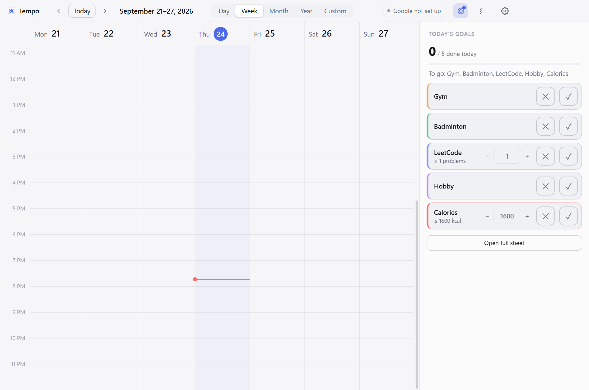
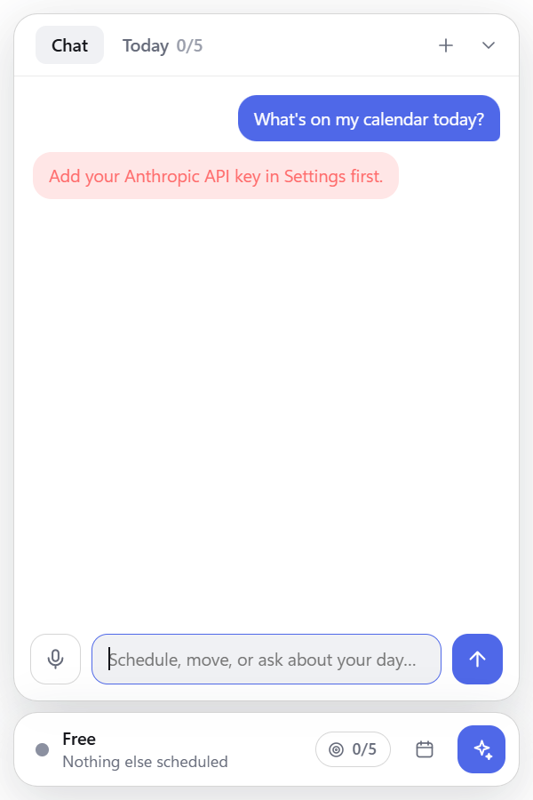
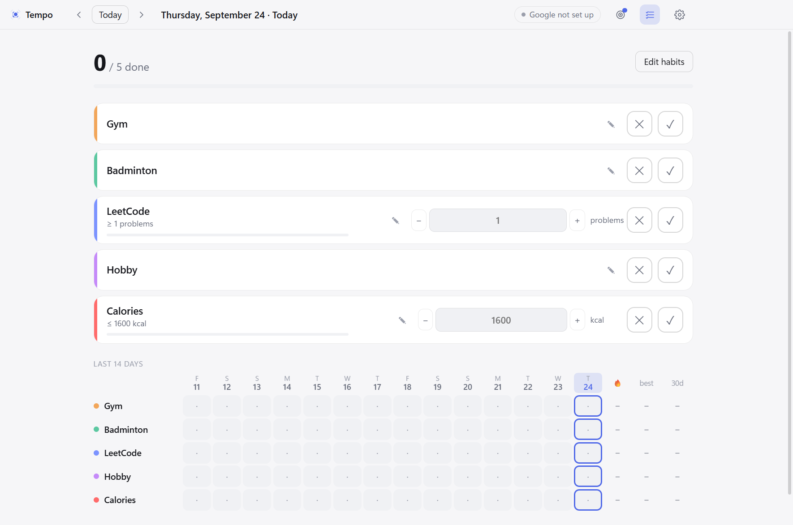
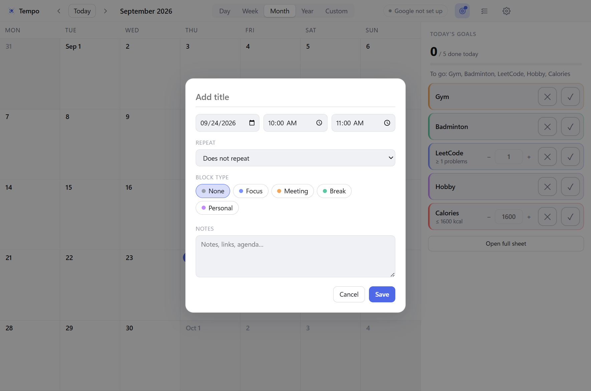
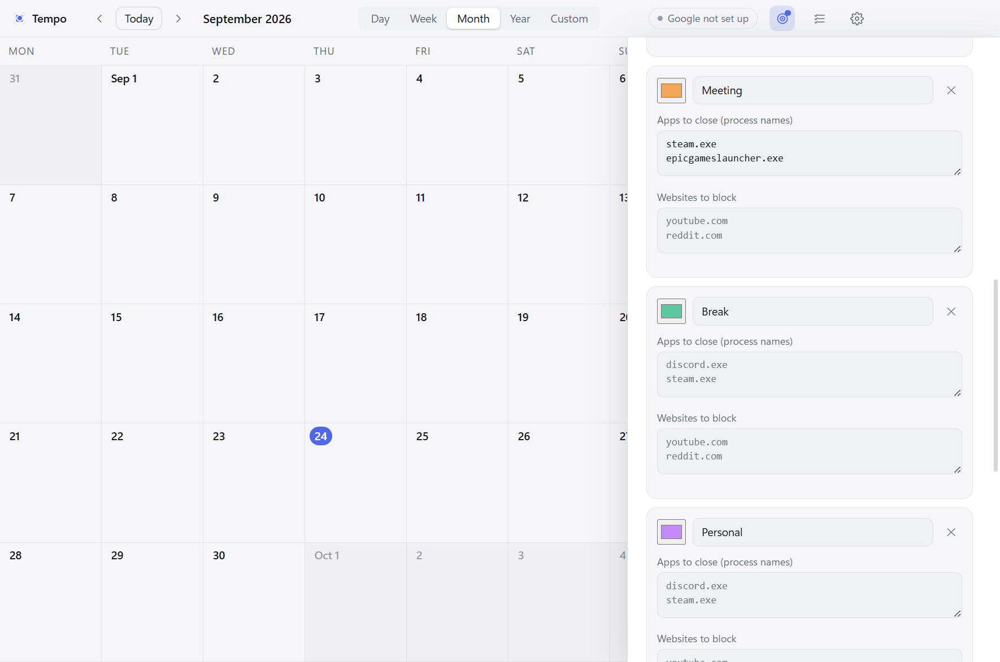
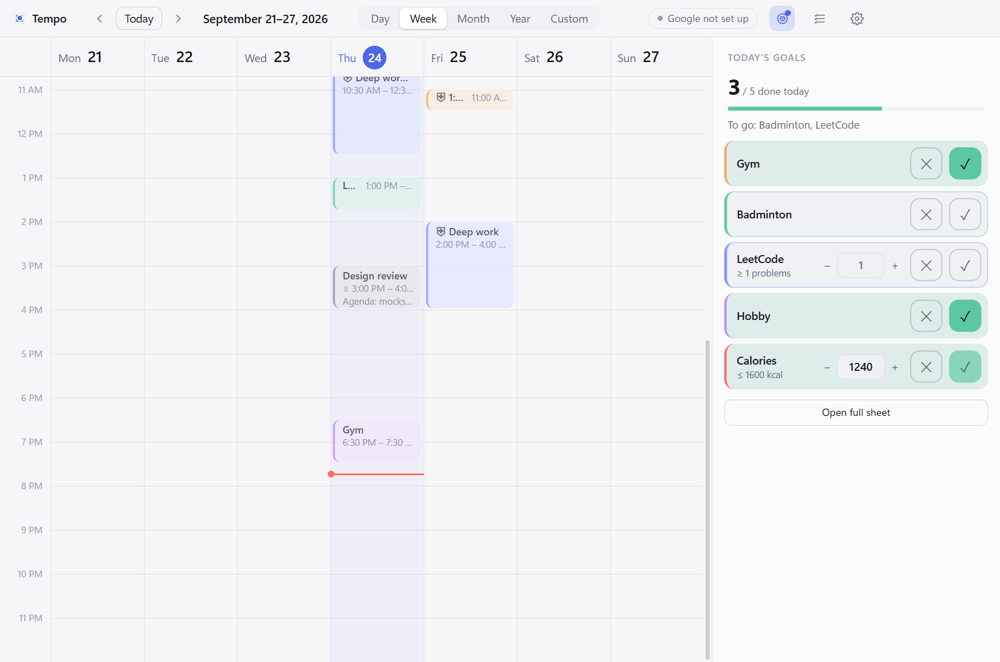
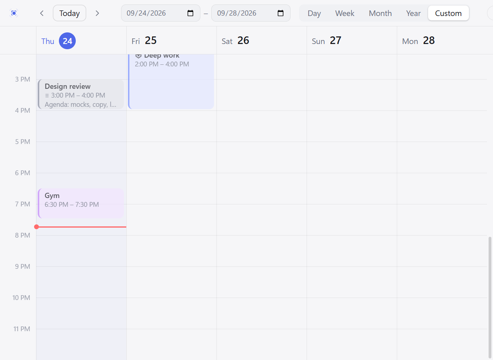
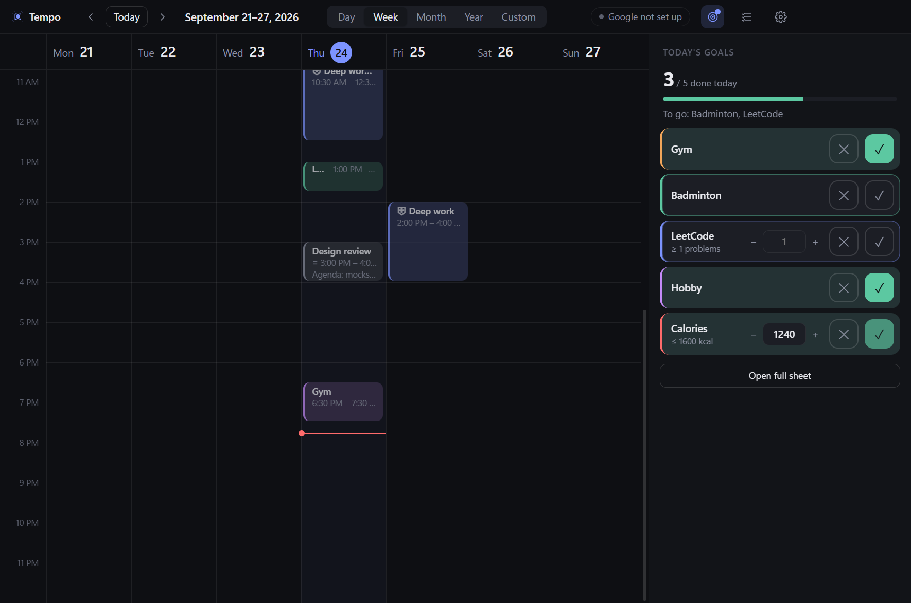
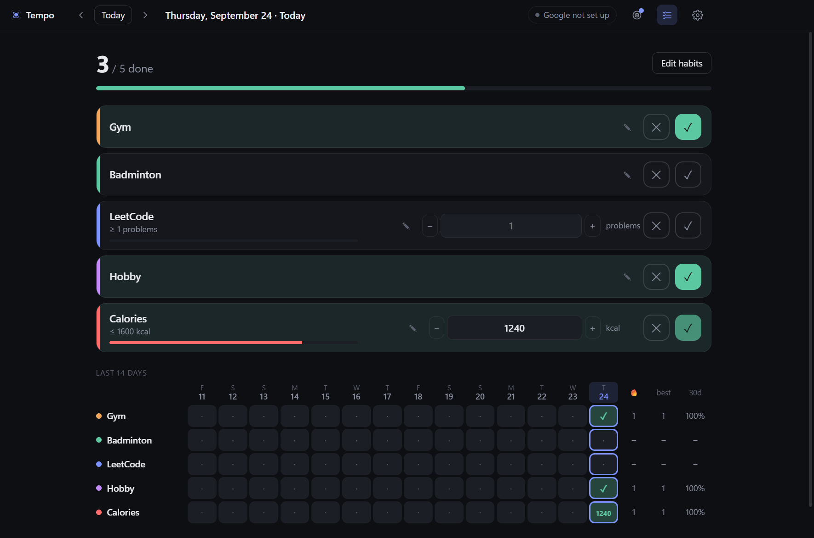

# Tempo UX audit (v0.1.0)

**Scope:** the desktop app as a first-time and daily user meets it: calendar (day/week/month/year/custom), event editor,
daily goals (panel, sheet, widget tab), floating widget + chat + voice, settings, focus-block enforcement, notifications.
**Date:** 2026-09-24. **Build:** tag `v0.1.0`. No product code was changed for this audit.

## Verdict

Tempo's core interaction design is strong: one-click goal logging, drag-to-create events, live voice text, a calm
visual language that holds up in dark mode. The problems are almost all at the edges: **first run, setup, small
windows, accessibility, and recovering from mistakes.** Two of the highest-impact issues are regressions I introduced
myself in recent releases (U1, U2). None require a redesign; most are days, not weeks.

**Fix first (in this order):**

1. **U1** The "Blocking" status chip is hidden in the default window size. Users can't tell a block is active.
2. **U2** At narrow widths the top bar clips its own buttons; Settings and (in Custom view) the goals button become unreachable.
3. **U5** Short events show their time but cut the title to one letter (Lunch renders as "L…").
4. **U3** First run is an empty calendar with no guidance; setup lives in a 2,300px settings scroll.
5. **U7 / U6** Text contrast and keyboard/screen-reader access fall below WCAG 2.2 AA.

## How this was done

- **Evidence over opinion.** I drove the real app in an isolated profile: a fresh first-run state, then a realistic
  week of events and goals, in light and dark themes and at the smallest window sizes. 28 screenshots were taken and
  reviewed; a script measured contrast, target sizes, focusability, labels and layout (numbers below are measured, not
  estimated).
- **Lenses:** Nielsen's ten heuristics, WCAG 2.2 AA, and task cost (clicks/steps for the jobs people hire this app for).
- **Not covered:** a real screen reader session, real microphone/multi-monitor behaviour, Windows high-contrast mode,
  long-session use, and testing with people other than the builder. Treat the accessibility section as "what a
  scan can prove", not a full conformance audit.

Severity: **P1** blocks or misleads a core task, or excludes users. **P2** real friction or risk. **P3** polish.

## What works well (keep)

- **Goal logging is nearly free:** 1 click per goal from the always-visible panel; numeric goals derive tick/cross.
- **Direct manipulation:** drag to create, move and resize; month drag-to-day; live voice text as you speak.
- **Consistent, calm visual system,** including a dark theme that is cohesive (no unstyled leftovers found).
- **Honest feedback:** tool-call chips in chat, sync chip states, progress bars that turn red over goal.
- **Soft override for blocks** respects autonomy; strict mode is available.
- **Sensible empty state in the widget** (suggested prompts), and events with notes are visibly marked (≡).

## Findings

### P1

**U1 · The active-block indicator is hidden in the default window** *(regression)*
Evidence: with a Focus block active, `#block-chip` reads "Blocking · Deep work: pitch deck · until 8:26 PM" but is
`display:none` at the default 1180px window (a `max-width:1180px` rule I added with the new views). It appears only above
1180px. The enforcement feature has no visible state where users look most.
Fix: remove the media rule; below ~1100px collapse the chip to a shield icon with tooltip. Also show "Blocking now:
what's closed/blocked" at the top of the goals panel. **Effort: S.**

**U2 · Top bar overflows; controls become unreachable at narrow widths** *(regression)*
Evidence (measured): at 900px the Settings button's right edge is at 920px (off-screen); in Custom view at 900px the
sheet button and sync chip are also off-screen. The goals panel is removed entirely at ≤1000px, so goals vanish with no
explanation. See `07-narrow-custom.png`.
Fix: move the view switcher into a dropdown under ~1000px; render the goals panel as a slide-over instead of removing
it; give the top bar `overflow` handling and a proper minimum width. **Effort: M.**

**U3 · No first-run guidance; setup is buried**
Evidence: `01-first-run-week.png` is a blank grid. Nothing says how to add an event, that voice/chat exist, or that Google
sync, the assistant, blocking and goals each need setup. The only pointer is a small grey "Google not set up" pill.
Connecting Google takes ~15 steps outside the app (Cloud project, API, consent screen, OAuth client, test user).
Fix: (a) empty-calendar prompt: "Click a time to add an event, or press Ctrl+Alt+T and say it"; (b) a dismissible
first-run checklist: *Connect Google (optional)* · *Pick your assistant* · *Choose apps and sites to block* · *Set your
goals*; (c) a "Load client_secret.json" button and step-by-step help for Google; (d) make the sync pill look like a button
until connected. **Effort: M–L.**

**U4 · Setting up blocks is developer-facing and easy to get wrong**
Evidence (`05-settings-block-types.png`): apps are typed as process names (`steamwebhelper.exe`); each type has two
free-text lists; **empty lists show grey example text that looks like real content** (Break and Personal appear to
contain `discord.exe`). Nothing explains that apps are force-closed (unsaved work is lost) or lets you preview what a
block will do. Website blocking needs a UAC step that sits at the bottom of a 2,300px scroll.
Fix: an app picker (running apps + installed apps with icons and friendly names), chip-style lists, real empty states,
"This will close: Discord, Steam · block: YouTube, Reddit" in the event editor, a "Test this block for 1 minute"
button, and plain-language warning about force-close. **Effort: L.**

**U5 · Short events hide the title, not the time**
Evidence (measured, 45-minute Lunch in a 127px column): title area 24px (truncated), time area 71px.
`06-week-realistic.png` shows "L… 1:00 PM –…". The always-visible 340px goals panel makes columns narrower.
Fix: title-first layout (hide time under a width/height threshold, show full details on hover/focus popover); consider
collapsing the goals panel to a 56px progress rail below ~1400px. **Effort: S.**

**U6 · Core objects are not keyboard- or screen-reader-operable**
Evidence (measured): 0 of 8 calendar events, 0 of 35 month cells and 0 of 8 month chips are focusable; the app has no
landmarks, no `role`/`aria-*` beyond titles, dialogs lack `role="dialog"`, `aria-modal` and a focus trap, chat and
toasts have no `aria-live`. Icon-only buttons rely on `title` alone. The goal tick/cross buttons are all named just
"Done"/"Missed", so a screen reader hears "Done, Done, Done" without the habit name. Date and time fields in the editor
are unlabeled (start vs end is implied by position).
Fix: make events real buttons (`aria-label="Deep work, 10:30 to 12:30"`), arrow-key navigation across the grid, Enter to
open; dialog semantics with focus trap and focus return; `aria-live="polite"` on chat and toasts; `aria-label` on every
icon button including the habit name ("Mark Gym done"); visible labels for Date/Start/End. **Effort: M.**

**U7 · Text contrast and size**
Evidence (measured): **11 of 43** sampled text styles fail WCAG AA in the light theme and **12 of 43** in dark. The
`--faint` color (used for hour labels, weekday headers, section titles, matrix dates, "other month" numbers) measures
**2.5:1 light / 3.0:1 dark** (needs 4.5:1). The light-theme error bubble is ~2.3:1; event times on tinted blocks are 3.6:1
in dark. About 35 text elements on the calendar screen are 11px or smaller.
Fix: raise `--faint` to ≥4.5:1 for text (e.g. `#6b7080` light, `#8f95a5` dark) and keep the current value only for
decorative lines; 12px minimum; darker red text on error bubbles. **Effort: S.**

### P2

**U8 · One concept, four names, two look-alike buttons.** The same feature is called *goals* (panel, chip, reminders),
*habits* (editor, sheet, assistant), *daily sheet* and *checklist*. Two adjacent toolbar icons (target = goals panel,
checklist = sheet) look interchangeable. Check/cross/pencil/arrows are text glyphs mixed with SVG icons.
Fix: choose "Goals" everywhere; one toolbar button (panel) with "Open full sheet" inside; SVG icons throughout. **S–M.**

**U9 · Placeholders read as values.** Empty number inputs show the goal in grey ("1600", "1") that looks like a saved
entry (`03-first-run-sheet.png`). Fix: neutral placeholders ("kcal"), keep the goal in the label. **S.**

**U10 · Mistakes are permanent.** Deleting a one-off event, dragging/resizing, removing a block type (`✕`, instant; events
silently keep a dangling type and stop enforcing), and any assistant `delete_event` cannot be undone. Removed habits are
archived but there is no way to restore them. Fix: an undo toast (~8s) plus Ctrl+Z for event edits; confirm or re-map
when removing a block type that is in use; an "Archived goals" list. **M.**

**U11 · The widget can't be put away.** It is always on top at the highest level (over full-screen video and games),
the tray icon toggles the chat rather than visibility, and there is no hide, opacity, size or "don't cover full-screen
apps" option. With the goals chip the collapsed pill is now 400px wide. Fix: tray "Hide widget", auto-hide over
full-screen apps, opacity/size options, remembered hidden state. **M.**

**U12 · Widget errors are dead ends.** `02-widget-error-dead-end.png`: "Add your Anthropic API key in Settings first." has no
button, and the widget has no settings; the message also names the API key even for users on Claude Code. Fix: actionable
error bubbles ("Open settings", "How to sign in"), provider-aware wording. **S.**

**U13 · Event editor clarity.** Unlabeled date/start/end; "Block type: None" doesn't say what block types do until
one is chosen; Ctrl+Enter and Esc are undiscoverable (`04-event-editor.png`). Fix: labels or an inline "to";
one-line explainer under Block type; show the "will close…" summary (see U4); keyboard hints in the footer. **S.**

**U14 · Settings is one 2,341px scroll over the calendar.** Order is Google OAuth credentials first, then assistant, block
types (the longest section), then enforcement, goals/reminders, hotkeys, hours. Jargon: "Enforcement", "Overrides /
block", "Warning seconds", "OAuth client secret". Changes save instantly with no confirmation. Fix: tabs
(Connections · Blocking · Goals & reminders · General), progressive disclosure for developer options, plain-language
labels, a subtle "Saved" indicator. **M.**

**U15 · The block alert exposes process names and can't be used from the keyboard.** Copy reads "steamwebhelper is blocked
right now"; nothing warns about unsaved work; the window opens inactive so Enter/Esc do nothing. Fix: friendly app names,
"Save your work: closing in 10s", focusable buttons with a shortcut, a Windows notification action for Allow. **S–M.**

**U16 · Morning events are above the fold.** The week/day grid opens scrolled to "now − 2h"; at 8 PM the 10:30 AM event shows
as a clipped sliver ("Deep wor…"), with no indicator that earlier events exist. Fix: scroll to today's first event and
show "▲ 2 earlier" edge markers. **S.**

**U17 · Shortcuts are hidden.** `d w m y c s g t`, arrows and drag gestures have no cheat sheet; global hotkeys appear only
at the bottom of Settings. Fix: `?` overlay, shortcut hints in tooltips. **S.**

**U18 · The goals panel is a fixed 340px (28% of the default window).** Great for visibility, costly for the calendar
(see U5). Fix: a slim collapsed mode (progress ring + tick strip), auto-collapse below ~1400px, remembered per user. **S–M.**

### P3

**U19 · Motion:** the widget's pulse/blink animations ignore `prefers-reduced-motion` (0 rules). **S.**
**U20 · Small targets:** number steppers are 20×28px (WCAG 2.5.8 asks for 24px); year cells are 25px. **S.**
**U21 · Matrix vs. stats mismatch:** an unlogged past day shows a neutral dot but counts as a miss in the 30-day rate and
streak. Show it as a faint ✕ or explain it. **S.**
**U22 · Voice:** auto-send after ~1s of silence with no "sending in…" affordance; the first-use ~80 MB model download is only a
small status line. **S.**
**U23 · Chat has no history across restarts** and no way to see what the assistant changed (ties into U10). **M.**

## Task cost today

| Job | Steps now | Notes |
|---|---|---|
| Add an event | 3 (click slot, type, Enter) | 1 hotkey + a sentence by voice |
| Log a goal | 1 click | no navigation needed |
| See that a block is active | **not visible** in the default window | needs widget open (2 clicks); see U1 |
| Connect Google | ~15, mostly outside the app | see U3 |
| Configure first block | 6+ (Settings, scroll, type process names, UAC) | needs Task Manager to find names; see U4 |
| Reach Settings in a small window | **impossible by mouse** below ~920px | see U2 |
| Undo a wrong delete | **not possible** | see U10 |

## Suggested order

**Sprint 1 (about 2 days): stop the bleeding.** U1, U2, U5, U7, U9, U12, U19, U20. Mostly CSS and copy.
**Sprint 2 (about 1 week): make it learnable.** U3 (first-run checklist + empty states), U8, U13, U16, U17, U18, U15.
**Sprint 3 (about 1–2 weeks): make it safe and inclusive.** U6 (keyboard/ARIA), U10 (undo), U4 (app picker + preview), U14 (settings restructure), U11.
Then re-run this audit's script (kept in the scratchpad harness) to confirm the measured numbers.

## Decisions needed from you

1. **Goals panel default:** always open (today), or open only on wide windows with a slim rail otherwise?
2. **Naming:** "Goals" everywhere, or keep "Habits" for the data and "Goals" for today's view?
3. **Onboarding depth:** a short 4-step checklist, or a guided wizard on first launch?
4. **Widget etiquette:** should it hide itself over full-screen apps by default?

## Screenshots

| | |
|---|---|
|  *U3: blank first run* |  *U12: dead-end error* |
|  *U9: placeholders look like values* |  *U13: unlabeled fields* |
|  *U4/U14: block lists, long scroll* |  *U5: squeezed titles* |
|  *U2: clipped top bar* |  *dark theme holds up* |
|  *dark sheet* | |
